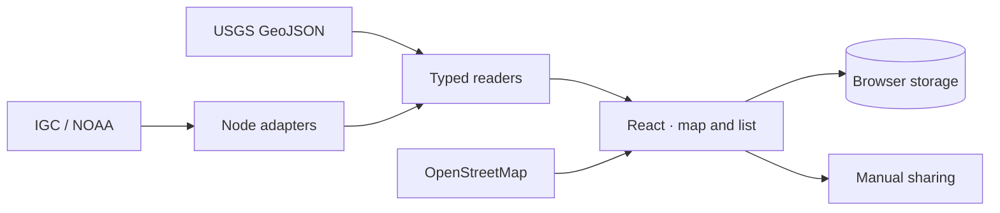

# Faro

[Extension guide](docs/extending-faro.md) · [Privacy](PRIVACY.md) · [Contributing](CONTRIBUTING.md) · [Country coverage](docs/country-coverage.md)

Faro is an open source web app for people away from home during an earthquake: travelers, work teams and anyone passing through an affected area. It shows earthquakes from official sources, helps people tell family or colleagues how they are, and keeps local emergency information at hand. The interface is available in English and Spanish and works on phones and computers.

**Status: early, pre-production release.** Earthquakes appear after the source publishes them. Faro does not predict earthquakes, is not an early warning system and does not replace instructions from local authorities.

## Run locally

Requirements: Node.js 24 LTS and npm 11 or later. No account, API key or `.env` file is needed.

```sh
git clone https://github.com/garagon/faro.git
cd faro
npm ci
npm run dev
```

Open the local URL printed by Vite. The dev server binds to `127.0.0.1` by default. To verify a build:

```sh
npm run check
npm run build
npm run preview
```

The dev and preview servers include the `/api/igc` and `/api/tsunami` adapters. **Copying `dist/client` to static hosting is not enough:** those routes need a compatible server. `vite preview` is a verification tool, not a production server. See [architecture and deployment](docs/architecture.md).

## What it includes

- **Earthquake activity.** USGS for the whole world and IGC (University of Panama) for Panama, each checked every 60 seconds while the tab is visible. Map, filters, list, magnitude, epicentre, event time and check time.
- **Tsunami information.** International NOAA/PTWC products with issue dates and explicit coverage limits.
- **Status messages.** Ready messages (for example "I'm OK, poor signal" or "I need medical care") as editable shortcuts. Location, companions, help needed, reachability and next check-in time. Preview in English or Spanish and manual sharing from any app. An earthquake report can be attached only when explicitly selected.
- **Local help.** Official emergency numbers and sources for nine destinations in the Americas, consular assistance where a verified listing exists, and pharmacy and hospital searches by area or approximate location. See [coverage and limits by country](docs/country-coverage.md).
- **Contacts.** Personal and work contacts (family, accommodation, insurer, consulate, employer, team coordinator and transport) for travelers and professionals on assignment.
- **Trip card.** Hotel plan and contacts saved in the browser, downloadable as an image or text for offline use. [Apple Wallet: requirements and limits](docs/apple-wallet.md).
- **Preparedness.** Situation guides with linked sources and a 14-item emergency kit checklist, saved locally and downloadable. [Emergency flows and magnitude colors](docs/emergency-ux.md).

Aftershocks are not inferred from proximity between events. A personal meeting point is not a certified shelter. Missing data does not mean there is no danger. Emergency numbers and diplomatic missions have limited coverage: see [sources and coverage](docs/data-sources.md).

## Architecture and extension points



The adapters never receive the traveler's profile. The map requests only the tiles in the current view. Geolocation and trip preparation stay in the browser.

| To extend…               | Start here                                                         |
| ------------------------ | ------------------------------------------------------------------ |
| An earthquake source     | [`src/catalogs/`](src/catalogs/) and the `CatalogReader` contract  |
| Polling and its states   | [`useCatalogFeed`](src/hooks/useCatalogFeed.ts)                    |
| A country or destination | [`src/data/destinations/`](src/data/destinations/) (one file each) |
| Diplomatic missions      | [`consularMissions.ts`](src/data/consularMissions.ts)              |
| Care search area presets | [`careAreas.ts`](src/data/careAreas.ts)                            |
| Ready status messages    | [`messageTemplates.ts`](src/lib/messageTemplates.ts)               |
| Safety guidance          | [`SafetyGuide.tsx`](src/components/SafetyGuide.tsx)                |
| Personal data storage    | [`browserStorage.ts`](src/lib/browserStorage.ts)                   |

The [extension guide](docs/extending-faro.md) includes a reader example, integration steps and the tests each change needs. Every source keeps its own timestamps, identity and coverage; catalogs are never merged automatically.

## Personal data

Profile, contacts, plans and history are stored in the browser on that device. There are no accounts, no profile server, no analytics and no sync between devices. Location requires permission and stays in memory unless the person copies coordinates into their plan.

External sources receive the network requests they need; the map provider receives the IP address, the site origin and the area being viewed. Sharing text or opening directions is always an explicit action. See the [privacy policy](PRIVACY.md).

## Development

| Command                   | Purpose                                                            |
| ------------------------- | ------------------------------------------------------------------ |
| `npm run check`           | Formatting, lint, types, tests and the publishable-files check     |
| `npm run format`          | Apply consistent formatting                                        |
| `npm test`                | Local tests with synthetic data, no external services              |
| `npm audit`               | Check dependencies for known vulnerabilities                       |
| `npm run prepare:release` | Validate, build and produce a source archive with SHA-256 manifest |

`artifacts/faro-source.tar.gz` excludes installed dependencies, builds, local secrets and test evidence. The scanner is an aid; review files before publishing them.

## License

Faro code is **Apache-2.0**: see [LICENSE](LICENSE) and [NOTICE](NOTICE). Country data derived from `world-countries` keeps ODbL-1.0; Natural Earth is public domain. Fonts, icons and libraries keep their own licenses. See [third-party notices](THIRD_PARTY_NOTICES.md).

Publishing the code does not mean it is approved for emergency use. See [release readiness and open operational items](docs/release-readiness.md).

## FAQ

**Is it realtime?** It checks every 60 seconds while the page is visible. Agencies can publish an event with a delay. It is not an early warning or a stream.

**Does it work outside Panama?** Yes. USGS covers the whole world. Local help and emergency numbers depend on verified records, and Faro never invents alternatives when information is missing.

**Can my family track me?** You can prepare and share a message. There is no remote tracking, guaranteed delivery or automatic alert if you stop replying.

**Does it work offline?** Downloaded text files do. The full app is not guaranteed to start offline. The browser may keep earlier data, shown with its update limits.

**Is it an official service?** No. Faro is an independent project that cites its sources. It is not affiliated with the agencies it mentions.

## Get involved

For code changes, start with [CONTRIBUTING.md](CONTRIBUTING.md). To add coverage, provide the official source, jurisdiction, review date and limitations. For ordinary bugs, open an issue with a synthetic example; report vulnerabilities through [private reporting](https://github.com/garagon/faro/security/advisories/new).

Initial maintainer: [@garagon](https://github.com/garagon). The community follows the [code of conduct](CODE_OF_CONDUCT.md).

## About

Faro was created by [Oktsec](https://oktsec.com). The public `/about.html` page documents sources, coverage and limits in English and Spanish without requiring JavaScript. Metadata and structured data describe the product without promising early warnings or full coverage. `llms.txt` makes this information easy to consult; it does not guarantee inclusion in search engines or AI answers.

Deployment settings and identifiers are kept out of the repository and the exported archive.
