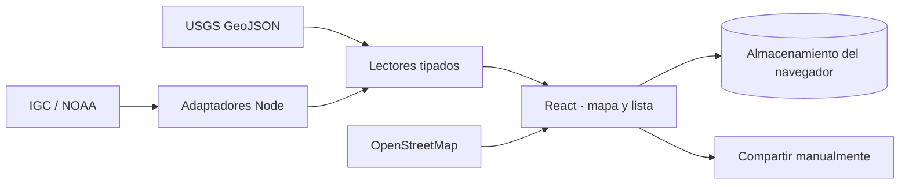

# Faro

[English](docs/README.en.md) · [Guía de extensión](docs/extending-faro.md) · [Privacidad](PRIVACY.md) · [Contribuir](CONTRIBUTING.md)

Faro permite consultar actividad sísmica de fuentes oficiales y preparar información personal para un viaje. La web funciona en español e inglés y se adapta a teléfonos y computadoras. Panamá es el punto de partida; USGS permite consultar otras regiones.

**Estado: versión inicial, previa a producción.** Los sismos se muestran después de su publicación. Faro no predice terremotos, no es un sistema de alerta temprana y no reemplaza las instrucciones de las autoridades locales.

## Empezar

Requisitos: Node.js 24 LTS y npm 11 o posterior. No necesitas cuentas, claves API ni un archivo `.env`.

```sh
git clone https://github.com/garagon/faro.git
cd faro
npm ci
npm run dev
```

Abre la dirección local que muestra Vite. El servidor se limita a `127.0.0.1` por defecto. Para comprobar la compilación:

```sh
npm run check
npm run build
npm run preview
```

El servidor de desarrollo y el de vista previa incluyen los adaptadores `/api/igc` y `/api/tsunami`. **Copiar `dist/client` a un alojamiento estático no basta:** esas rutas necesitan un servidor compatible. `vite preview` es una herramienta de comprobación, no un servidor de producción. Consulta [arquitectura y despliegue](docs/architecture.md).

## Qué incluye

- IGC/Universidad de Panamá para Panamá y USGS para el catálogo global, consultados por separado cada 60 segundos mientras la pestaña está visible.
- Mapa automático con OpenStreetMap, filtros, lista, magnitud, epicentro, hora del evento y hora de consulta.
- Productos internacionales de tsunami de NOAA/PTWC, con fecha de emisión y límites de cobertura explícitos.
- Onboarding con nombre, teléfono, correo, nacionalidad y destino guardados localmente; ayuda consular cuando hay una representación verificada en el directorio.
- Búsqueda de farmacias y hospitales por lugar o ubicación aproximada, con apertura manual de Google Maps y enlaces sanitarios oficiales.
- Mochila de emergencia: lista de 14 elementos, guardada localmente y descargable, e instrucciones ilustradas.
- Ayuda local con teléfonos y fuentes oficiales para nueve destinos de América; [cobertura y límites por país](docs/country-coverage.md).
- Plan del hotel y contactos personales guardados en el navegador, con ficha visual descargable como imagen o texto para consultar sin conexión. [Apple Wallet: requisitos y límites](docs/apple-wallet.md).
- Mensajes de estado con lugar, acompañantes, ayuda necesaria, disponibilidad y próxima hora de contacto; vista previa en español o inglés y envío manual. Puede adjuntarse un reporte sísmico seleccionado explícitamente.
- Recomendaciones por situación en español e inglés, con enlaces a sus fuentes. [Flujos de emergencia y criterio de colores](docs/emergency-ux.md).

La relación de réplica no se deduce de cercanía entre sismos. Un punto personal no es un refugio certificado. La falta de datos no significa ausencia de peligro. Los teléfonos y las misiones diplomáticas tienen cobertura limitada: [fuentes y cobertura](docs/data-sources.md).

## Arquitectura y extensiones



Los adaptadores no reciben el perfil del viajero. El mapa consulta solo las teselas de la vista actual. La geolocalización y la preparación del viaje se mantienen del lado del navegador.

| Quieres extender…         | Punto de entrada                                               |
| ------------------------- | -------------------------------------------------------------- |
| Una fuente sísmica        | [`src/catalogs/`](src/catalogs/) y el contrato `CatalogReader` |
| La consulta y sus estados | [`useCatalogFeed`](src/hooks/useCatalogFeed.ts)                |
| Países y vista inicial    | [`regions.ts`](src/lib/regions.ts)                             |
| Teléfonos de emergencia   | [`emergency.ts`](src/lib/emergency.ts)                         |
| Misiones diplomáticas     | [`consularMissions.ts`](src/data/consularMissions.ts)          |
| Instituciones y recursos  | [`resources.ts`](src/lib/resources.ts)                         |
| Recomendaciones           | [`SafetyGuide.tsx`](src/components/SafetyGuide.tsx)            |
| Datos personales locales  | [`browserStorage.ts`](src/lib/browserStorage.ts)               |

La [guía de extensión](docs/extending-faro.md) incluye un lector de ejemplo, pasos de integración y pruebas necesarias. Cada nueva fuente mantiene sus fechas, identidad y cobertura; no se mezclan catálogos automáticamente.

## Datos personales

El perfil, los contactos, los planes y el historial se guardan en el navegador de ese dispositivo. No hay cuentas, servidor de perfiles, analítica ni sincronización entre dispositivos. GPS requiere permiso y permanece en memoria salvo que la persona copie coordenadas a su plan.

Las fuentes externas reciben las solicitudes de red necesarias; el proveedor del mapa recibe la IP, el origen de la web y el área consultada. Compartir texto o abrir una ruta es una acción explícita. [Política de privacidad](PRIVACY.md).

## Desarrollo

| Comando                   | Uso                                                                      |
| ------------------------- | ------------------------------------------------------------------------ |
| `npm run check`           | Formato, lint, tipos, pruebas y control de archivos publicables          |
| `npm run format`          | Aplicar formato uniforme                                                 |
| `npm test`                | Pruebas locales con datos sintéticos, sin depender de servicios externos |
| `npm audit`               | Consultar vulnerabilidades conocidas de dependencias                     |
| `npm run prepare:release` | Validar, compilar y generar un archivo de fuentes con manifiesto SHA-256 |

El archivo `artifacts/faro-source.tar.gz` excluye dependencias instaladas, compilaciones, secretos locales y evidencia de pruebas. El escáner es una ayuda; revisa los archivos antes de publicarlos.

## Licencia

Código de Faro: **Apache-2.0**, ver [LICENSE](LICENSE) y [NOTICE](NOTICE). Los países derivados de `world-countries` mantienen ODbL-1.0; Natural Earth es de dominio público. Las fuentes, iconos y bibliotecas conservan sus licencias. Ver [atribuciones](THIRD_PARTY_NOTICES.md).

La publicación del código no equivale a aprobar el uso en emergencias. [Revisión de publicación y pendientes operativos](docs/release-readiness.md).

## Preguntas frecuentes

**¿Es realtime?** Consulta cada 60 segundos con la página visible. El organismo puede publicar un evento con demora; no es una alerta temprana ni streaming.

**¿Funciona fuera de Panamá?** USGS permite explorar otras regiones. La cobertura de ayuda local y teléfonos depende de los registros verificados; no se inventan alternativas cuando falta información.

**¿Mi familia puede seguirme?** Puedes preparar y compartir un mensaje. No hay seguimiento remoto, entrega garantizada ni aviso automático si dejas de responder.

**¿Funciona sin internet?** Los textos descargados sí. La web completa no garantiza arranque offline. El navegador puede conservar datos previos, que se muestran con sus límites de actualización.

**¿Es un servicio oficial?** No. Faro es un proyecto independiente y cita las fuentes utilizadas. No está afiliado a los organismos mencionados.

## Participar

Para cambios de código, empieza por [CONTRIBUTING.md](CONTRIBUTING.md). Para ampliar cobertura, aporta la fuente oficial, jurisdicción, fecha y limitaciones. Para fallas ordinarias, abre un issue con un ejemplo sintético; para vulnerabilidades usa [el canal privado](https://github.com/garagon/faro/security/advisories/new).

Mantenedor inicial: [@garagon](https://github.com/garagon). La comunidad se rige por el [código de conducta](CODE_OF_CONDUCT.md).

## Creado por Oktsec

Faro es una herramienta creada por [Oktsec](https://oktsec.com). La página pública `/about.html` documenta fuentes, cobertura y límites en español e inglés, sin requerir JavaScript. Los metadatos y datos estructurados describen el producto sin prometer alertas tempranas ni cobertura completa. `llms.txt` facilita la consulta de esta información; no garantiza inclusión en buscadores o respuestas de IA.

Las configuraciones e identificadores de despliegue se mantienen fuera del repositorio y del archivo exportado.
