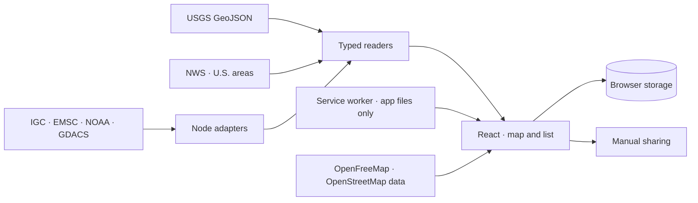

# Faro

[Extension guide](docs/extending-faro.md) · [Privacy](PRIVACY.md) · [Contributing](CONTRIBUTING.md) · [Country coverage](docs/country-coverage.md)

Faro is an open source web app for people away from home during an emergency (earthquakes, tsunami, hurricanes and floods): travelers, work teams and anyone passing through an affected area. It shows what official sources publish for the place, helps people tell family or colleagues how they are, and keeps local emergency information at hand. The interface is available in English, Spanish and Brazilian Portuguese and works on phones and computers.

**Status: early, pre-production release.** Events appear after the source publishes them. Faro does not predict earthquakes or storms, is not an early warning system and does not replace instructions from local authorities or meteorological services.

## Run locally

Requirements: Node.js 24 LTS and npm 11 or later. No account, API key or `.env` file is needed.

```sh
git clone https://github.com/garagon/faro.git
cd faro
npm ci
npm run dev
```

Open the local URL printed by Vite. The dev server binds to `127.0.0.1` by default. To verify a build:

```sh
npm run check
npm run build
npm run preview
```

The dev and preview servers include the seven adapters: `/api/igc`, `/api/emsc`, `/api/tsunami`, `/api/alerts`, `/api/storms`, `/api/national` and `/api/sinaproc`. **Copying `dist/client` to static hosting is not enough:** those routes need a compatible server. `vite preview` is a verification tool, not a production server. See [architecture and deployment](docs/architecture.md).

## Install on your phone

Use **Install Faro** in the country toolbar. Android browsers that support installation can show a native install prompt; otherwise follow the browser-menu instructions. On iPhone or iPad, open Faro in Safari, choose **Share → Add to Home Screen**, keep **Open as Web App** enabled if offered, and tap **Add**. Desktop Chrome and Edge also support installation.

Installation adds a home-screen icon and standalone window. After the first visit, a service worker stores the application files so Faro opens without a signal: emergency numbers, the emergency screen, guidance, your plan and contacts. The service worker never stores `/api/` responses or map tiles. The app itself keeps the last answer of the earthquake catalogue, the national weather warnings and SINAPROC's posts on the device and shows them offline marked "last data" with their retrieval time, never as current; warnings still disappear at their own expiry time. Refreshing them needs a connection. There are no background earthquake alerts. Data remains local to the browser/app and site origin; verify your profile after installation or a domain change. No automatic data migration is performed.

## What it includes

- **My trip, ready to send.** One form, all optional: your details, an emergency contact, health, travel insurance, accommodation and dates. It produces a short card you can send by WhatsApp, Telegram, SMS, email or any app, or save as an image. Health details are included only if you choose. Nothing leaves the browser unless you send it.
- **Emergency-first home.** Call the local emergency number, tell family you are OK or see what to do now in one tap; then warnings in force, a map with the status of each hazard and the detail by source. Nothing blocks the first visit: a card asks only for your nationality, to show your embassy.
- **Emergency screen.** One tap from every screen (a full screen, not a popup): the local emergency number; first-minute actions for the situation the person selects (earthquake, hurricane or storm, flood) plus steps for any emergency, each cited (CDC, Ready.gov, NOAA/NWS, FCC); your embassy's verified phones; your saved meeting point and the latest published earthquake. Works without completing onboarding.
- **National weather warnings.** Warnings in force from the national meteorological service where it publishes an active alert feed (Panama IMHPA, Costa Rica IMN, Dominican Republic INDOMET, Ecuador INAMHI, Argentina SMN), shown as published. Destinations link their service's warnings page (Argentina pending).
- **Translation of official text.** In English and Portuguese, warnings and posts published only in Spanish are marked as such and can be translated on request: on the device where the browser supports it, or through Google Translate (text or full page). Translations are labeled automatic; the Spanish original is the official text.
- **Civil protection posts (Panama).** The latest SINAPROC communiqués, prevention notices and incident reports, in Spanish, with their publication time and a link; drill posts are left out. Without a flood warning in force, a post from the last 48 hours that mentions rain or flooding is pointed out in the home flood row. A post has no expiry and is never presented as a warning in force.
- **Active tropical cyclones.** NOAA National Hurricane Center storms for places in the Atlantic, Caribbean and Pacific basins, with wind, position, advisory time and links to the official advisory (Spanish when NHC publishes it for that storm) and cone. NWS hurricane and flood alerts for U.S. states and territories.
- **Situation overview.** One card per hazard for the selected country: earthquakes (largest in the period), tsunami (NOAA/PTWC), tropical cyclones, floods and volcanoes (GDACS events updated in the last 72 hours). Cards state what each source lists, never a safety rating; active cyclone, flood and volcano points also appear on the map.
- **Earthquake activity.** USGS and EMSC for the whole world and IGC (University of Panama) for Panama, each checked every 60 seconds while the tab is visible and never merged. If a source fails, Faro keeps its last copy marked as older and offers another source in one tap. Map, filters, list, latest and largest event of the period, epicentre, event time and check time.
- **Official impact data.** For USGS events: PAGER alert, ShakeMap maximum intensity, "Did You Feel It?" report counts and a link to report what you felt (USGS or EMSC). Shown as published; Faro computes none of it.
- **International alerts.** GDACS (UN and European Commission) green, orange and red alerts for the selected country: earthquakes, tropical cyclones, floods, volcanoes, droughts and wildfires. Automatic humanitarian-impact estimates, not local warnings.
- **Tsunami information.** International NOAA/PTWC products with issue dates and explicit coverage limits, plus NWS tsunami alerts when a U.S. state or territory is selected.
- **Works offline after the first visit.** The application, emergency numbers, guidance and saved data open without a signal; official data shows its last check time.
- **Status messages.** The person picks why they are writing (earthquake, hurricane or storm, flooding, evacuation, other emergency or a trip update). Ready messages (for example "I'm OK, poor signal" or "I need medical care") are editable shortcuts. Location, companions, help needed, reachability and next check-in time. Preview in English, Spanish or Portuguese and manual sharing from any app. An earthquake report can be attached only when explicitly selected.
- **Local help.** Official emergency numbers and sources for 14 destinations in the Americas (including Guatemala, El Salvador, Honduras, Nicaragua and the Dominican Republic), consular assistance where a verified listing exists, pharmacy and hospital searches by area or approximate location, and official family reunification services (ICRC, IFRC directory, American Red Cross for U.S. areas). See [coverage and limits by country](docs/country-coverage.md).
- **Travelers from the United States, Argentina and Brazil.** Nationality-specific packs from the State Department, Argentina's Cancillería and Brazil's Itamaraty: consular emergency lines with who may call, registration or advisories where official, lost passports, insurance and crisis guidance. In Panama, each of the three embassies has a sourced card with its emergency phone and a map pin. Official links open on request; no automatic enrollment or live advisory claims. The data registry supports adding other nationalities.
- **Contacts.** Personal and work contacts (family, accommodation, insurer, consulate, employer, team coordinator and transport) for travelers and professionals on assignment.
- **Trip card.** Hotel plan and contacts saved in the browser, downloadable as an image or text for offline use. [Apple Wallet: requirements and limits](docs/apple-wallet.md).
- **Preparedness.** Guides grouped by hazard (earthquake and tsunami; hurricane before, during and after; flood; volcano and ash; preparation) with original illustrations, official sources and NHC watch/warning terms, plus a go bag section that calculates water for your group, adds items for the hazards you choose and lists what is missing by shop with nearby searches, saved locally and downloadable. [Emergency flows and magnitude colors](docs/emergency-ux.md).

Aftershocks are not inferred from proximity between events. A personal meeting point is not a certified shelter. Missing data does not mean there is no danger. Emergency numbers and diplomatic missions have limited coverage: see [sources and coverage](docs/data-sources.md).

## Architecture and extension points



The adapters never receive the traveler's profile. The map requests only the tiles in the current view. Geolocation and trip preparation stay in the browser.

| To extend…               | Start here                                                         |
| ------------------------ | ------------------------------------------------------------------ |
| An earthquake source     | [`src/catalogs/`](src/catalogs/) and the `CatalogReader` contract  |
| Polling and its states   | [`useCatalogFeed`](src/hooks/useCatalogFeed.ts)                    |
| A country or destination | [`src/data/destinations/`](src/data/destinations/) (one file each) |
| Diplomatic missions      | [`consularMissions.ts`](src/data/consularMissions.ts)              |
| Care search area presets | [`careAreas.ts`](src/data/careAreas.ts)                            |
| Ready status messages    | [`messageTemplates.ts`](src/lib/messageTemplates.ts)               |
| Safety guidance          | [`SafetyGuide.tsx`](src/components/SafetyGuide.tsx)                |
| Personal data storage    | [`browserStorage.ts`](src/lib/browserStorage.ts)                   |

The [extension guide](docs/extending-faro.md) includes a reader example, integration steps and the tests each change needs. Every source keeps its own timestamps, identity and coverage; catalogs are never merged automatically.

## Personal data

Profile, contacts, plans and history are stored in the browser on that device. There are no accounts, no profile server, no analytics and no sync between devices. Location requires permission and stays in memory unless the person copies coordinates into their plan.

External sources receive the network requests they need; the map provider receives the IP address, the site origin and the area being viewed. Sharing text or opening directions is always an explicit action. See the [privacy policy](PRIVACY.md).

## Development

| Command                   | Purpose                                                            |
| ------------------------- | ------------------------------------------------------------------ |
| `npm run check`           | Formatting, lint, types, tests and the publishable-files check     |
| `npm run format`          | Apply consistent formatting                                        |
| `npm test`                | Local tests with synthetic data, no external services              |
| `npm audit`               | Check dependencies for known vulnerabilities                       |
| `npm run prepare:release` | Validate, build and produce a source archive with SHA-256 manifest |

`artifacts/faro-source.tar.gz` excludes installed dependencies, builds, local secrets and test evidence. The scanner is an aid; review files before publishing them.

## License

Faro code is **Apache-2.0**: see [LICENSE](LICENSE) and [NOTICE](NOTICE). Country data derived from `world-countries` keeps ODbL-1.0; Natural Earth is public domain. Fonts, icons and libraries keep their own licenses. See [third-party notices](THIRD_PARTY_NOTICES.md).

Publishing the code does not mean it is approved for emergency use. See [release readiness and open operational items](docs/release-readiness.md).

## FAQ

**Is it realtime?** It checks every 60 seconds while the page is visible. Agencies can publish an event with a delay. It is not an early warning or a stream.

**Does it work outside Panama?** Yes. USGS covers the whole world. Local help and emergency numbers depend on verified records, and Faro never invents alternatives when information is missing.

**Can my family track me?** You can prepare and share a message. There is no remote tracking, guaranteed delivery or automatic alert if you stop replying.

**Does it work offline?** After a first visit, the app opens without a signal with emergency numbers, guidance and your saved data. Official reports and the map need a connection; earlier data is shown with its last check time, never as current. Downloaded text files also work offline.

**Is it an official service?** No. Faro is an independent project that cites its sources. It is not affiliated with the agencies it mentions.

## Get involved

For code changes, start with [CONTRIBUTING.md](CONTRIBUTING.md). To add coverage, provide the official source, jurisdiction, review date and limitations. For ordinary bugs, open an issue with a synthetic example; report vulnerabilities through [private reporting](https://github.com/garagon/faro/security/advisories/new).

Initial maintainer: [@garagon](https://github.com/garagon). The community follows the [code of conduct](CODE_OF_CONDUCT.md).

## About

Faro was created by [Oktsec](https://oktsec.com). The public `/about.html` page documents sources, coverage and limits in English, Spanish and Portuguese without requiring JavaScript. Metadata and structured data describe the product without promising early warnings or full coverage. `llms.txt` makes this information easy to consult; it does not guarantee inclusion in search engines or AI answers.

Deployment settings and identifiers are kept out of the repository and the exported archive.
